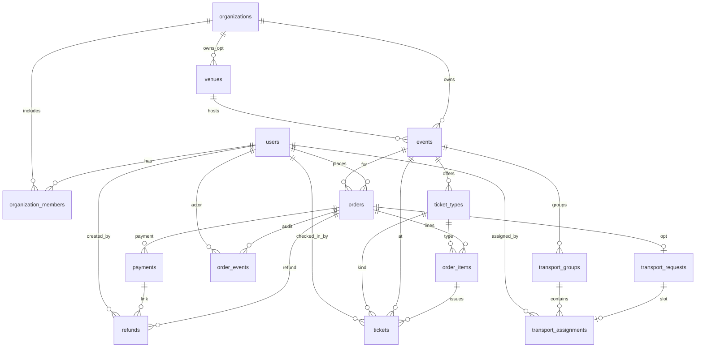
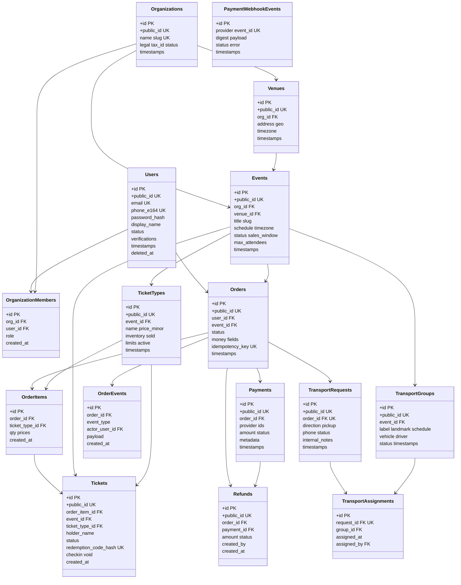

# Database model — diagrams, ORM mirroring, security (001–004)

Canonical SQL:

- Core MVP: `001_initial_schema.sql`, `002_security_grants_rls.sql`
- Platform extensions: `003_platform_extensions.sql`, `004_platform_security.sql` (optional)

Full column lists: `docs/DATABASE_FIELD_REFERENCE.md` + `docs/DATABASE_FIELD_REFERENCE_PLATFORM.md`.

---

## ORM choice (to mirror this schema in code)

| Tool | Best when | Mirroring |
|------|-----------|-----------|
| **Drizzle** + drizzle-kit | SQL files stay source of truth; TS close to Postgres | Hand-write `schema.ts` from the field references, or run **`drizzle-kit introspect`** on a DB with 001–004 applied, then tidy enums/types. |
| **Prisma** | You want Prisma Client and one `schema.prisma` | Apply migrations, then **`prisma db pull`**, or hand-write models and avoid drift. |
| **TypeORM** | NestJS + decorators | Entities per table; **`synchronize: false`**; align columns to the reference. |

**002 reminder:** ORMs map tables/columns only. **RLS and roles** (`eventapp_web`, `eventapp_worker`, `SET LOCAL app.user_id`) stay in how you connect and query.

---

## ER diagram (relationships)

---

## Class-style view (entities as “classes”)

---

## Security objects (002 only — not extra tables)

| Object | Role |
|--------|------|
| Schema `app` | Namespace |
| `app.session_user_id()` | Reads GUC `app.user_id` for RLS |
| `eventapp_migrator` | Owns schema; migrations |
| `eventapp_web` | API pool; RLS; `SET LOCAL app.user_id` per txn |
| `eventapp_worker` | BYPASSRLS; webhooks + ticket insert + payments/refunds insert |
| Policies + FORCE RLS | All public tables per `002_security_grants_rls.sql` |
| Revokes | e.g. `payment_webhook_events` not for web; no web INSERT on `tickets`/`payments`/`refunds` |

---

## Platform ER extensions (003) — relationships

```mermaid
erDiagram
  events ||--o{ event_tags : tagged
  tags ||--o{ event_tags : used
  organizations ||--o{ promo_codes : owns
  events ||--o{ promo_codes : scoped
  promo_codes ||--o{ order_promo_applications : applied
  orders ||--o{ order_promo_applications : uses
  users ||--o{ waitlist_entries : joins
  events ||--o{ waitlist_entries : for
  ticket_types ||--o{ waitlist_entries : optional
  orders ||--o{ waitlist_entries : fulfilled
  organizations ||--o{ organizer_payout_profiles : profile
  organizations ||--o{ payout_batches : settlements
  payout_batches ||--o{ payout_batch_items : lines
  orders ||--o{ payout_batch_items : included
  notification_templates ||--o{ notification_jobs : template
  users ||--o{ notification_jobs : recipient
  users ||--o{ file_assets : uploaded
  organizations ||--o{ file_assets : org
  events ||--o{ file_assets : media
  file_assets ||--o{ data_subject_export_requests : archive
  users ||--o{ data_subject_export_requests : subject
  users ||--o{ analytics_events : tracked
  users ||--o{ user_event_favorites : saves
  events ||--o{ user_event_favorites : favorited
  users ||--o{ cart_sessions : owns
  cart_sessions ||--o{ cart_lines : lines
  events ||--o{ cart_lines : item
  ticket_types ||--o{ cart_lines : type
  users ||--o{ referral_codes : shares
  referral_codes ||--o{ referral_attributions : converts
  users ||--o{ referral_attributions : referred
  orders ||--o{ referral_attributions : first_order
  users ||--o{ user_security_tokens : challenges
  users ||--o{ user_marketing_preferences : prefs
```

**004** layers RLS + revokes on these tables (see `004_platform_security.sql`). Worker-only: `analytics_events`, `audit_admin_events`, `user_security_tokens`; template mutations; platform-wide promo validation path.

---

## MVP readiness and future extensions

**Core (001+002):** identity, org RBAC, venues/events, catalog, checkout orders, payments + webhook dedupe, refunds row, ticket rows (hash-only codes), audit stream, transport MVP + grouping.

**Platform (003+004):** discovery tags, promos, waitlist, organizer payout batches, notification templates + jobs, file metadata, feature flags, admin audit log, GDPR export requests, analytics sink, favorites, multi-event carts, referrals, auth token hashes, marketing consent.

**Still optional later:** seat maps, disputes/chargebacks, organizer SaaS subscriptions, dedicated platform-staff RBAC tables, advanced tax jurisdictions.

---

## Apply order

See `database/how_to_apply.txt`: **001 → 002** (required); **003 → 004** (optional platform).
